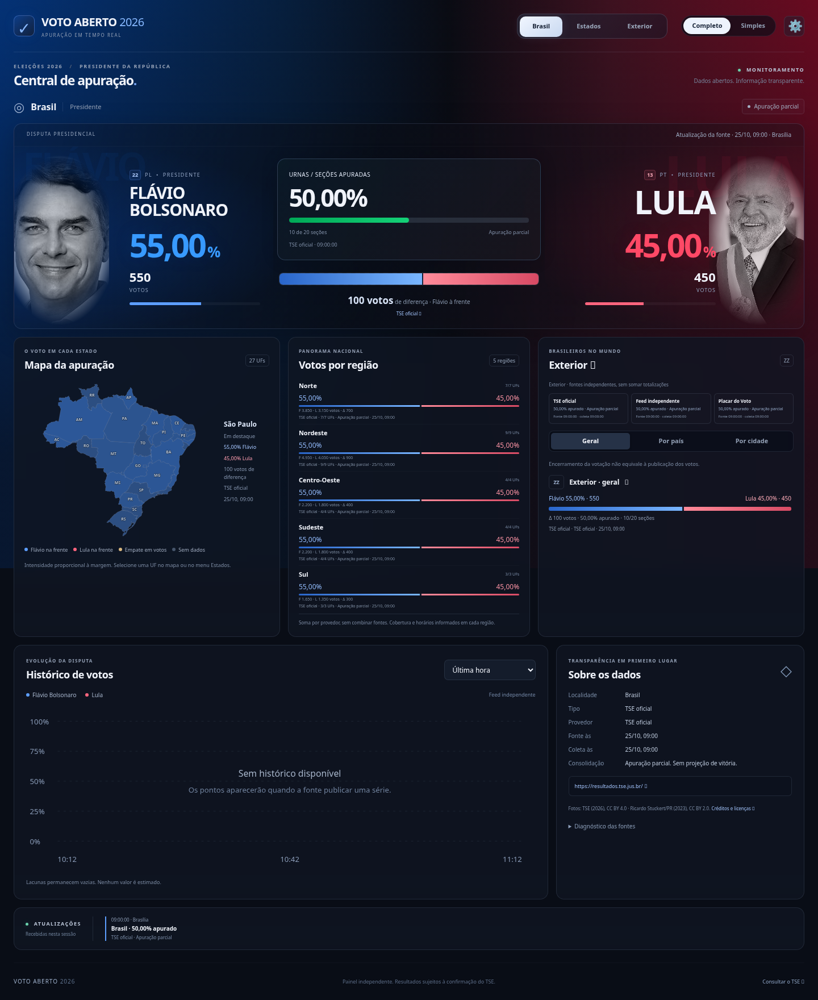

# Validação da reconstrução

Executada em 25/10/2026 com Node 24.19.0, npm 11.9.0 e Chromium do ambiente.

| Verificação                                                              | Resultado                                                                                     |
| ------------------------------------------------------------------------ | --------------------------------------------------------------------------------------------- |
| `npm ci --cache /workspace/.npm`                                         | Instalação pelo lockfile concluída                                                            |
| `npm test`                                                               | 30 testes passaram, nenhum falhou/pulou                                                       |
| `npm run build`                                                          | Build concluído com base `/voto-aberto-2026/`                                                 |
| `npm run verify:pages`                                                   | 3 testes passaram: artefatos, subpath e indisponibilidade sem API                             |
| `PLAYWRIGHT_CHROMIUM_EXECUTABLE_PATH=/usr/bin/chromium npm run test:e2e` | 17 testes passaram, nenhum falhou/pulou                                                       |
| Navegador em 1440/1280/768/390/360 px                                    | Sem overflow horizontal ou erros de console no cenário válido                                 |
| Proxy real com `NODE_USE_ENV_PROXY=1`                                    | Resultados Brasil, ZZ, Austrália; locais, histórico e comparação de fontes respondendo        |
| Consulta aos provedores para ZZ                                          | TSE, feed e Placar: apuração não iniciada; 0/1.351 seções na resposta consultada              |
| Consulta por país                                                        | Austrália: feed independente, 0/29 seções; nenhum voto publicado na resposta consultada       |
| Descoberta de localidades                                                | 160 registros publicados: países e cidades dos destaques                                      |
| Histórico ao vivo do exterior                                            | Vazio; indisponibilidade explicitada, sem linha inventada                                     |
| G1, UOL e CNN                                                            | Acesso às páginas eleitorais bloqueado pelo proxy (CONNECT HTTP 403); integração não validada |
| Publicação/merge                                                         | Não executados; requer backend público e configuração de build para dados no Pages            |

Os testes de navegador incluem produção servida no subpath, API ausente/inacessível, dados parciais, percentuais nulos, modos, seleção por mapa/select, seleção de país/cidade, histórico vazio/com lacunas, tooltip por foco, sanitização de texto, fonte independente sem etiqueta de vitória, cancelamento de resposta antiga, imagens locais, fallback e comparação de provedores.

## Capturas do cenário de teste

**Os números nas imagens abaixo vêm de fixtures interceptadas exclusivamente pelo teste de navegador. Não são resultados eleitorais reais e não fazem parte dos fallbacks da aplicação.** As capturas servem para revisar composição e responsividade. O aplicativo publicado consulta o backend ou exibe indisponibilidade.

### Desktop · 1440 px

### Celular · 390 px

A configuração reutilizável da nuvem foi salva em rascunho (`install_script`, `start_skill`, domínios necessários). Isso não comprova publicação ou restauração do snapshot em uma tarefa nova.

## Atualização: Pages sem backend e eleições históricas

- Build sem `VITE_API_BASE_URL` agora carrega coleta real em `/data/results.json`, com origem e horário, substituindo o erro obrigatório anterior.
- 2026: 1º/2º turnos, 29 localidades por turno; primeiro turno com 12 candidatos na coleta feita.
- 2022: acervo independente explicitamente identificado, 29 localidades por turno, 11 candidatos no primeiro e 2 no segundo. Soma de cada candidato em 27 UFs + ZZ coincide com o Brasil. Seções omitidas porque não foram revalidadas na fonte original.
- Configuração da URL do backend no navegador, com opção persistente de retornar aos dados publicados.
- Novos testes de troca de ano/turno/candidatos, procedência do acervo, configuração de conexão e descarte de resposta de backend que não confirme o ano/turno solicitado.
- O detalhamento por país/cidade ainda requer backend e contrato correspondente; arquivos publicados incluem o total de ZZ, sem inventar países ou histórico.

A rodada final desta atualização passou em **34 testes de dados/servidor, 21 testes de navegador e 3 verificações de Pages (58 no total)**. `npm ci`, build sem API e consultas HTTP reais com ano/turno também concluídos. As capturas `screenshots/2022-first-desktop.png` e `screenshots/2022-first-mobile.png` mostram os registros históricos reais do primeiro turno, com origem identificada; não usam mocks.
